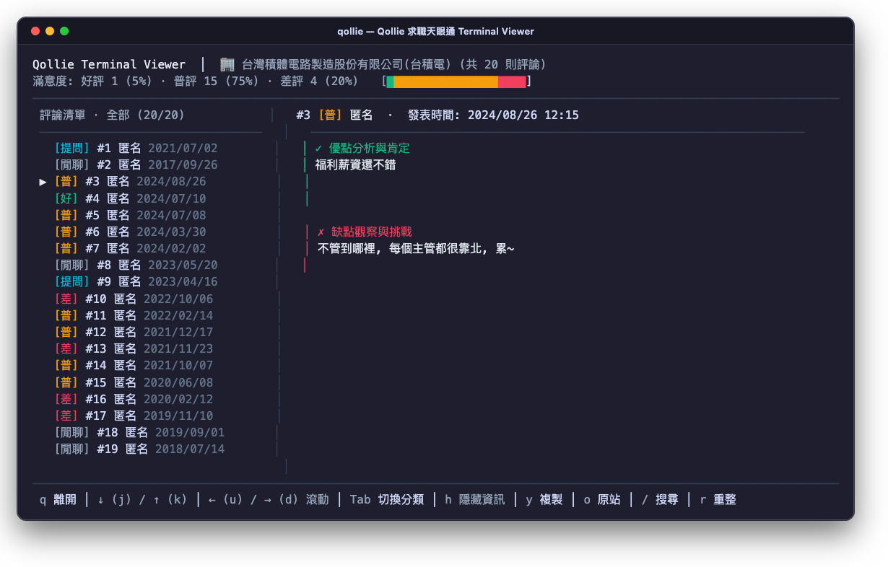
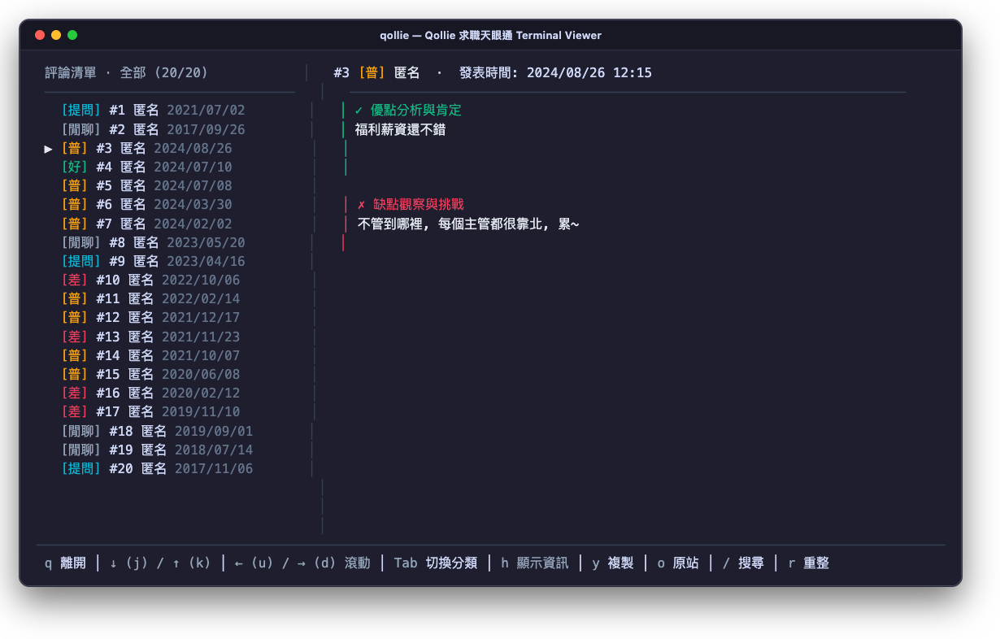
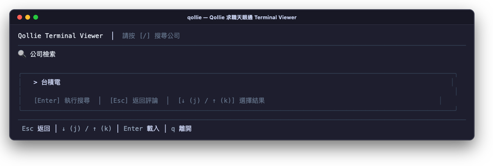

# Qollie Terminal Viewer

> 在終端機中優雅瀏覽 Qollie (求職天眼通) 公司評論與心得的現代化 TUI 應用程式。

[](https://github.com/sonnytf/qollie-terminal-viewer/releases)
[](#下載與安裝)
[](#下載與安裝)
[](LICENSE)

> [!IMPORTANT]
> **本專案為「純終端檢視與閱覽器 (View-only / Read-only)」**
> - **無需登入帳號**：打開即用，極速查詢與無痕閱讀公司心得與面試評價。
> - **不支援留言/撰寫評論**：為維持極輕量（~7MB 單一靜態二進位檔）與零帳號負擔，不內建登入與發文功能。
> - **原站直達**：若欲留言或發表心得，請於任一評論按 `o` 鍵，即可在系統預設瀏覽器秒開該公司 Qollie 頁面。

---

<p align="center">
  
</p>

---

## ✨ 功能特色

- ⚡ **超輕量單一靜態二進位**：僅 ~7MB，無相依依賴，下載即用。
- 🖥️ **雙欄 Master-Detail 自適應佈局**：
  - **頂部大盤**：即時統計星級評分、推薦率分佈與評論總數。
  - **左欄清單**：直覺瀏覽評論標題、作者身份與發布日期；支援 `Tab` 切換「心得 / 討論 / 提問」。
  - **右欄詳情**：對齊閱讀優缺點與留言回覆，智慧折行、零字元斷詞截斷。
- ⌨️ **Vim 風格鍵盤導航**：完全免按 Shift，支援 `j` / `k`、`d` / `u`、`g` / `G` 高效穿梭。
- 📋 **快速複製與原站跳轉**：按 `y` 快速複製完整格式化評論至剪貼簿；按 `o` 秒開瀏覽器跳轉原站。
- 👁️ **沉浸閱讀模式**：隨時按 `h` 收合頂部資訊列，垂直可視高度立即擴增 +4 行。
- 🔍 **即時公司搜尋**：內建搜尋引導，支援中文公司名稱或 ID 快速檢索。
- 🎨 **現代化護眼終端配色**：升級 Catppuccin Mocha 暖黑護眼基調，透明精緻外框與陰影，長時間閱讀不眩光。

---

### 🖥️ 實際介面展示

#### 🏢 雙欄 Master-Detail 瀏覽與即時滿意度大盤
> 整合頂部推薦率統計長條圖（好／普／差評比例）、左欄分類評論清單與右欄優點肯定與缺點挑戰對齊詳情。

<p align="center">
  
</p>

#### 📖 沉浸閱讀模式 (`h` 鍵一鍵收合概覽)
> 閱讀長篇心得時，隨時按 `h` 鍵收合頂部公司資訊列，垂直視野立即擴增 +4 行。

<p align="center">
  
</p>

#### 🔍 即時公司檢索引導
> 支援輸入中文公司關鍵字或 Qollie 公司 ID，搭配方向鍵快速挑選目標企業。

<p align="center">
  
</p>

---

## 🚀 下載與安裝

從 **[GitHub Releases](https://github.com/sonnytf/qollie-terminal-viewer/releases)** 下載適合你作業系統與架構的執行檔（**純單一執行檔，免解壓縮**）：

| 作業系統 / 架構 | 檔案名稱 | 說明 |
| :--- | :--- | :--- |
| **macOS Apple Silicon** | `qollie-macos-arm64` | M1 / M2 / M3 / M4 晶片 |
| **macOS Intel** | `qollie-macos-amd64` | x86_64 架構 |
| **Linux 64-bit** | `qollie-linux-amd64` | 一般 x86_64 伺服器 / PC |
| **Linux ARM64** | `qollie-linux-arm64` | aarch64 / 樹莓派 / 雲端 ARM |
| **Windows 64-bit** | `qollie-windows-amd64.exe` | 一般 Windows x64 架構 |
| **Windows ARM64** | `qollie-windows-arm64.exe` | Windows on ARM (Snapdragon / Surface 等) |

### 快速安裝範例 (macOS / Linux)

```bash
# 1. 賦予下載的檔案執行權限
chmod +x qollie-macos-arm64

# 2. (選用) 重新命名並移動至系統 PATH 方便隨處輸入 qollie 執行
sudo mv qollie-macos-arm64 /usr/local/bin/qollie
```

---

## 📖 使用方式

```bash
# 1. 直接啟動互動式介面 (進入搜尋畫面)
qollie

# 2. 帶入關鍵字直接搜尋公司
qollie 台積電
qollie 聯發科

# 3. 指定精準公司全名或 Qollie 公司 ID
qollie -n 台灣積體電路製造股份有限公司
qollie --id 5860c66430162b7e4c17de29

# 4. 指定評論擷取筆數上限 (預設 50 筆)
qollie 台積電 --limit 100
```

---

## ⌨️ 鍵盤快捷鍵指南

| 按鍵 | 動作說明 |
| :--- | :--- |
| `↓` 或 `j` | 評論清單向下移動 |
| `↑` 或 `k` | 評論清單向上移動 |
| `Tab` | 切換評論分類（心得 / 討論 / 提問） |
| `→` 或 `d` | 評論內容向下滾動（半頁） |
| `←` 或 `u` | 評論內容向上滾動（半頁） |
| `g` | 跳至第一筆評論 |
| `G` | 跳至最後一筆評論 |
| `h` | 切換顯示 / 隱藏頂部公司概覽資訊（擴增視野） |
| `y` 或 `c` | 複製當前選中評論完整內容至系統剪貼簿 |
| `o` | 在預設瀏覽器開啟該公司 Qollie 原站頁面 |
| `/` 或 `s` | 重新開啟搜尋公司畫面 |
| `r` | 重新整理當前公司評論 |
| `q` 或 `Ctrl+C` | 退出程式 |

---

## 📄 授權條款

本專案基於 [MIT License](LICENSE) 釋出。
所有評論數據版權屬於 [Qollie (求職天眼通)](https://www.qollie.com) 及原發文作者所有。
